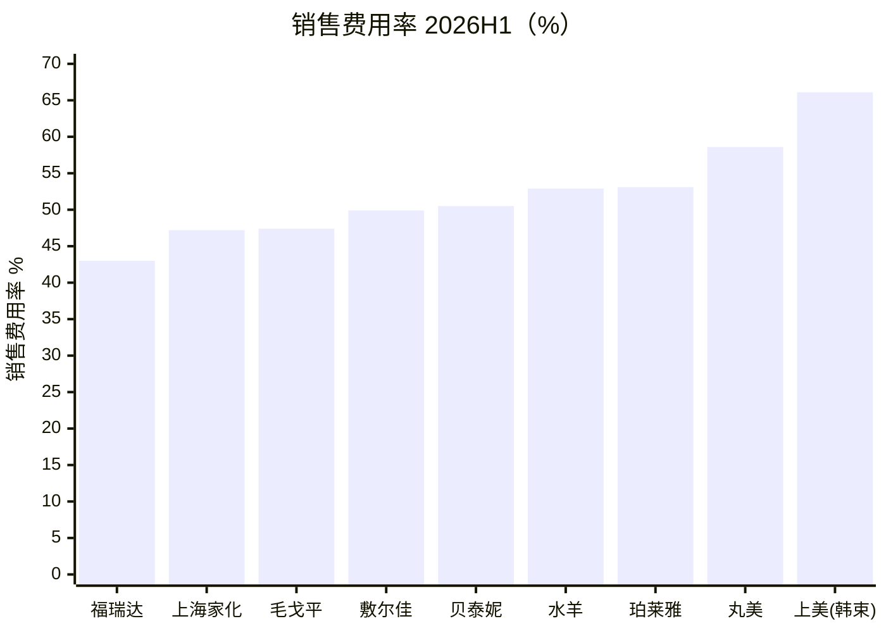
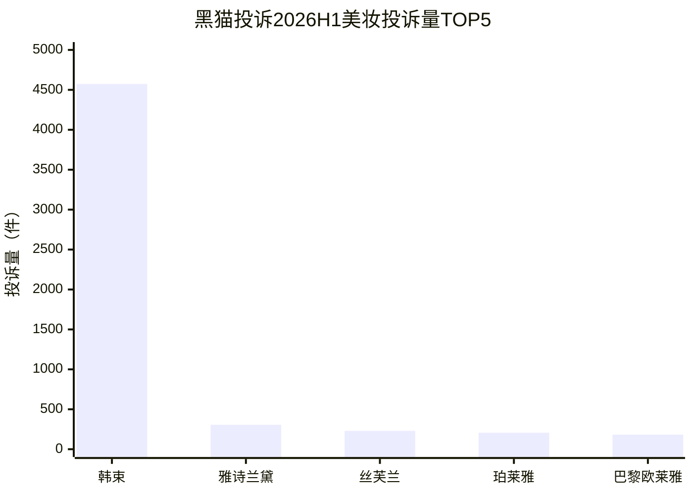
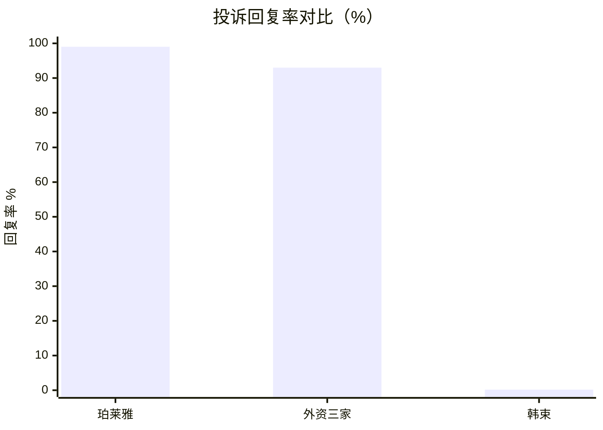

# 国货美妆品牌健康度与舆情风险分析（2026H1）

> 数据与调研日期：2026-10-11
> 数据源：iFinD（A 股公司 2026 半年报利润表，实测拉取）；上美股份/毛戈平/林清轩为港股，采用财新、东方财富、同花顺等公开报道口径；投诉数据来自黑猫投诉官方《2026 上半年美妆投诉数据报告》（2026-07-16 发布）及黑猫红黑榜。
> 口径提醒：福瑞达报表口径为集团整体（含医药业务），化妆品板块单列标注；上美/毛戈平为港股，费用科目口径与 A 股"销售费用"略有差异，对比时已注明。

---

## 0. 摘要（一句话版本）

**2026 上半年国货美妆出现明显分化：以韩束/上美为代表的"流量换增长"模式正式触顶（营收 -8.6%、净利 -79.4%、销售费用率 66.1%、黑猫投诉占全行业 47.2% 而回复率仅 0.17%），以毛戈平、敷尔佳、林清轩为代表的"品牌资产+产品力"路线逆势高增；舆情风险与财务健康度高度相关——投诉失控的品牌，正是费用率最畸形的品牌。**

---

## 1. 财务面：营销费用与营收的"剪刀差"

九家国货美妆上市公司 2026H1 核心指标（A 股为 iFinD 实测，港股为公开报道口径）：

| 公司 | 营收(亿) | 营收YoY | 销售费用率 | 剪刀差(费用增速-营收增速) | 归母净利(亿) |
|---|---|---|---|---|---|
| 珀莱雅 | 53.75 | +0.2% | 53.1% | +7.2pp | 11.68 |
| 上海家化 | 37.91 | +9.0% | 47.2% | +8.3pp | 3.81（+43.4%） |
| 上美股份(韩束) | 37.56 | -8.6% | 66.1% | — | 1.08（-79.4%） |
| 毛戈平 | 32.67 | +26.2% | 47.4% | +6.4pp | 8.05（+20.3%） |
| 贝泰妮(薇诺娜) | 25.92 | +9.3% | 50.5%（↓3.7pp） | -7.4pp | 2.92 |
| 水羊股份 | 25.10 | +0.4% | 52.9% | +8.1pp | 0.87 |
| 福瑞达 | 19.09 | +6.7% | 43.0% | +20.8pp | 0.82（-24.3%） |
| 丸美生物 | 16.63 | -5.8% | 58.6% | +3.4pp | 1.55 |
| 敷尔佳 | 11.56 | +33.9% | 49.9% | +3.6pp | 2.56 |
| 林清轩(补充) | 15.0 | +42.6% | — | — | 2.56（+40.7%） |

三个关键读数：

1. **行业销售费用率中枢已到 47%-53%**，即每收 100 元，一半上下要拿去买流量；
2. **剪刀差为正的公司有 6 家**（费用涨得比营收快），其中珀莱雅（+0.2% 营收 vs +7.4% 费用）是"行业一哥也开始买不动增长"的标志性信号；福瑞达剪刀差 +20.8pp 最激进（费用 +27.5%），其集团净利已 -24.3%；
3. **剪刀差为负的只有贝泰妮一家**（-7.4pp），薇诺娜母公司在主动降费用率修复报表，是唯一"反向操作"的玩家。

## 2. 舆情面：黑猫投诉的断层式集中

黑猫投诉官方 2026H1 美妆报告（行业总投诉约 1 万件）：

- **韩束 4574 件，占全行业 47.2%**——第二名雅诗兰黛 306 件（3.2%），丝芙兰 230 件，珀莱雅 207 件（2.1%），巴黎欧莱雅 182 件。断层式集中；
- **回复率两极**：珀莱雅 99.03%（行业第一），丝芙兰/欧莱雅/雅诗兰黛均 93%+，**韩束仅 0.17%**——投诉基本是"挂在网上没人理"的状态；
- 投诉类型分布：成分问题 34.2%（违规添加/过敏/原料）、虚假宣传 9.96%、价格 3.57%；
- 时间曲线：1 月因韩束 EGF 事件单日峰值破 500 件、环比 +166.3%，2-6 月回落到常态低位——**一次大舆情把半年投诉曲线打成了脉冲**；
- 投诉人群 20-40 岁占 92.03%，正是美妆核心消费人群。

韩束事件链（2025.12–2026.9）：央视《经济半小时》曝光红蛮腰等产品检出违禁成分 EGF（人表皮生长因子）、399 元套装被报道成本仅 26 元 → 1 月投诉爆发 → 防脱洗发水"七天长发赔一万"虚假宣传争议 → 8 月半年报净利暴跌近八成 → 9 月黑猫累计投诉 6264 条、已完成仅 2420 条。

## 3. 2026 争议事件四分类（与财务面交叉验证）

| 类型 | 案例 | 对应财务信号 |
|---|---|---|
| A. 功效宣称越界 | 薇诺娜"祛痘印"宣称未备案被处罚；韩束防脱"七天赔一万" | 贝泰妮费用率主动下调修复中；上美费用率 66.1% 失控 |
| B. AI 生成冒犯广告 | 百雀羚"纵欲过度的女人"；谷雨羞辱式控油广告 | 非上市/未披露，但反映行业 AI 内容审核缺位 |
| C. 价格与高端化争议 | 谷雨 800 元精华水被嘲；花西子眉笔事件长尾 | 对照组：毛戈平高端化成功（毛利率 84.8%、复购率 27.2%） |
| D. 产品诚信 | 烙色贴标罚 30 万；韩束 EGF 违禁添加 | 韩束投诉占行业 47.2%、净利 -79.4%，舆情与财务双杀 |

## 4. 品牌健康度矩阵（红黄绿灯）

评分维度：增长（营收 YoY）、营销效率（费用率+剪刀差）、舆情风险（2026 争议事件严重度）、售后口碑（投诉占比+回复率，仅黑猫披露品牌可得）。

| 公司 | 灯 | 一句话画像 |
|---|---|---|
| 上美(韩束) | 🔴 红 | 模式崩塌样本：费用率最高+投诉断层第一+回复率 0.17%+净利 -79%，舆情与财务互相强化 |
| 丸美生物 | 🟠 偏红 | 营收负增长 + 费用率 58.6%，还没爆雷但结构最脆弱 |
| 水羊股份 | 🟡 黄 | 营收停滞、剪刀差 +8.1pp，淘系代运营基因的品牌化阵痛 |
| 福瑞达 | 🟡 黄 | 费用 +27.5% 激进扩张，化妆品板块(+17.6%)与集团净利(-24.3%)背离，观察 |
| 珀莱雅 | 🟡 黄 | 基本盘最稳（净利 11.68 亿、回复率 99%），但 +0.2% 的增速宣告大单品+流量打法见顶 |
| 贝泰妮(薇诺娜) | 🟢 转好 | 唯一主动降费用率的公司，宣称违规处罚轻、舆情长尾是"包装漏液"类品控问题 |
| 上海家化 | 🟢 绿 | 2024 亏损深蹲后连续修复（净利 +43.4%），老牌国货的渠道瘦身逻辑兑现 |
| 敷尔佳 | 🟢 绿 | +33.9% 高增，费用同步扩张但增长覆盖得住 |
| 毛戈平 | 🟢 优等生 | 高端化唯一跑通：+26.2% 增长、84.8% 毛利率、27.2% 复购率；风险点是营销推广 +44.2% 超营收增速，需盯 |
| 林清轩 | 🟢 绿 | +42.6% 增速全场最快，精华油大单品路线 |

## 5. 结论

1. **"流量换增长"模式在 2026H1 正式触顶**：费用率 50%+ 成为行业常态后，继续加投放换不来增长（珀莱雅 +0.2%），反而挤压利润（上美 -79%）；
2. **舆情风险可以用财务指标前置预警**：韩束爆雷前，其"费用率 66%+渠道 90% 依赖线上+大单品占比过高"的结构已经是高危形态。高危画像 = 费用率 >55% + 营收停滞 + 大单品/单渠道依赖；
3. **投诉回复率是零成本的品牌健康度探针**：0.17% vs 99.03% 的差距不需要爬数据，黑猫公开页就能看；
4. **高端化的胜负手是复购不是定价**：毛戈平 27.2% 复购率 vs 谷雨 800 元精华水被嘲——价格带跃迁必须有品牌资产和复购垫底。

## 6. 口径与局限

- 福瑞达为集团口径（含医药），化妆品板块 12.86 亿（+17.6%）单列；
- 上美销售费用率 66.1% 为报道口径（含推广开支），与 A 股"销售费用"科目范围略宽；
- 黑猫投诉量受品牌线上体量影响，未做销售规模归一化（珀莱雅体量大于韩束但投诉仅 207 件，结论方向不变）；
- 未上市公司（谷雨、花西子、百雀羚、烙色）无财报数据，仅纳入舆情分类不进入矩阵评分。

## 附：核心图表（Mermaid 渲染）

## 复现

- `data/beauty_financials_2026h1.csv`：九家公司 2026H1 核心指标（含来源标注）
- `analysis.py`：四张图的一键复现代码，运行后输出 `figures/beauty_health_2026H1.png`
